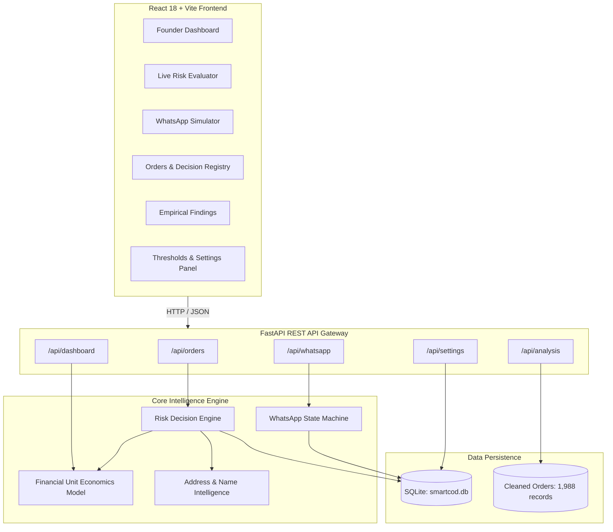
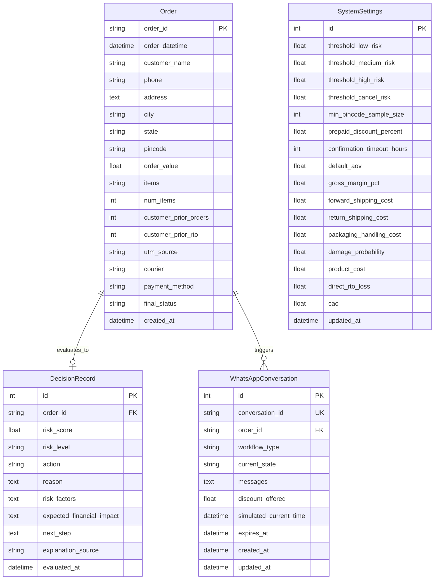

# SmartCOD AI — System Architecture & Technical Specification

## 1. System Overview

**SmartCOD AI** is an intelligent Cash on Delivery (COD) risk scoring and Return-to-Origin (RTO) prevention platform designed for high-growth direct-to-consumer (D2C) ecommerce brands on Shopify.

The system addresses the core economic dilemma of Indian ecommerce: **preventing reverse logistics losses without prematurely alienating genuine customers or destroying Meta ad customer acquisition investments.**

---

## 2. Core Components & Responsibilities

### 2.1 Backend Services (`backend/services/`)

#### 1. `RiskEngine` (`backend/services/risk_engine.py`)
- Evaluates COD order features available at checkout time (no target leakage).
- Incorporates **Empirical Bayes (Laplace) smoothed pincode priors** ($m=10$) across 461 pincodes to prevent penalizing low-sample areas.
- Evaluates **customer history** (14.00% clean repeat baseline vs 45.07% prior RTO baseline).
- Emits calibrated risk probability ($0.03 \le p \le 0.98$) and maps it to exactly one of 4 business actions based on dynamic settings thresholds:
  1. `SHIP_AS_IS` (Score $\le 0.20$)
  2. `SHIP_AFTER_CONFIRMATION` ($0.20 < \text{Score} < 0.45$)
  3. `NUDGE_TO_PREPAID` ($0.45 \le \text{Score} < 0.68$, or AOV $> \text{₹}1,000$)
  4. `HOLD_OR_CANCEL` ($\text{Score} \ge 0.68$, or defective address / chronic abuser)

#### 2. `FinancialModel` (`backend/services/financial_model.py`)
- Enforces the verified assignment unit economics:
  - **AOV:** ₹649.00
  - **Gross Margin:** 62% $\rightarrow$ **Delivered Gross Profit:** ₹402.38
  - **Direct RTO Loss:** $\text{₹}65 + \text{₹}65 + \text{₹}25 + (0.08 \times \text{₹}180) = \text{₹}169.40$
  - **Customer Acquisition Cost (CAC):** ₹300.00
- Evaluates expected contribution value:
  $$E[V] = (1 - p_{\text{rto}}) \times \text{Gross Profit} - p_{\text{rto}} \times \text{Direct RTO Loss}$$
- Computes break-even and optimal prepaid incentive discounts (e.g., 8% discount = ₹52 off, generating ₹15 net cash savings vs COD RTO risk).

#### 3. `LLMAddressIntelligence` (`backend/services/llm_service.py`)
- Evaluates unstructured delivery addresses and customer names.
- Recognizes Hinglish delivery cues (*"peepal ke ped ke samne"*, *"doodh dairy ke pass"*, *"call karke aana"*), granting trust bonuses for authentic local landmarks.
- Detects placeholder/bogus addresses (*"xyz"*, *"home"*, *"test"*, length $< 15$).
- Flags synthetic customer names (*"asdf"*, *"test order"*, single-letter initials).
- **Deterministic Fallback:** Operates 100% offline without requiring paid API keys, reporting `explanation_source = "DETERMINISTIC_RULES"` (or `"LLM"` when keys are supplied).

#### 4. `WhatsAppSimulatorService` (`backend/services/whatsapp_service.py`)
- State machine managing two distinct customer conversational workflows:
  - **Workflow A (Ship After Confirmation):** Sends order details $\rightarrow$ customer replies YES (Confirmed, dispatch authorized) or NO (Cancelled, dispatch stopped) or ambiguous text (clarification prompt).
  - **Workflow B (Nudge to Prepaid):** Sends discount offer $\rightarrow$ customer replies PAY (generates payment link) or KEEP (retains COD) $\rightarrow$ simulated UPI payment triggers instant status upgrade to `PREPAID`.
- **Time Stepper Simulation:** Supports advancing time by +1h, +6h, +24h to trigger SLA timeout transitions.

---

## 3. Database Schema (SQLite & SQLAlchemy 2.0)

---

## 4. API Endpoints Specification

| Method | Endpoint | Description |
| :--- | :--- | :--- |
| `GET` | `/api/health` | Health check endpoint returning engine status. |
| `GET` | `/api/dashboard/summary` | Aggregated founder KPIs, 4 decision bucket counts, date filter, and financial impact. |
| `GET` | `/api/orders` | Paginated orders registry with search, status/courier/channel filters, and privacy masking. |
| `GET` | `/api/orders/{id}` | Detailed order record with full decision audit log and active WhatsApp threads. |
| `POST` | `/api/orders/evaluate` | Interactive evaluation of arbitrary order payloads in real-time. |
| `POST` | `/api/orders` | Ingests a new live COD order and evaluates it immediately. |
| `GET` | `/api/settings` | Retrieves current thresholds and financial unit economics parameters. |
| `PUT` | `/api/settings` | Updates operational thresholds and financial parameters with validation. |
| `POST` | `/api/whatsapp/start` | Initiates Workflow A (Confirmation) or Workflow B (Prepaid Nudge). |
| `POST` | `/api/whatsapp/{id}/reply` | Submits simulated customer response to the state machine. |
| `POST` | `/api/whatsapp/{id}/advance-time` | Simulates time progression (+1h, +6h, +24h) to test SLA timeouts. |
| `POST` | `/api/whatsapp/{id}/simulate-payment`| Simulates completion of UPI checkout link for prepaid conversion. |
| `GET` | `/api/analysis/findings` | Returns statistical findings and holdout backtest distributions. |

---

## 5. Security & Privacy Safeguards
1. **PII Masking:** Customer phone numbers are masked in all API responses (`98******45`).
2. **Local Data Isolation:** All historical and evaluated orders reside in local SQLite databases; no customer data is transmitted to third-party endpoints unless an explicit LLM API key is configured.
3. **Target Leakage Prevention:** The decision engine strictly isolates features available at the moment of order placement. Historical delivery labels (`final_status`) are used exclusively for offline empirical prior estimation.
